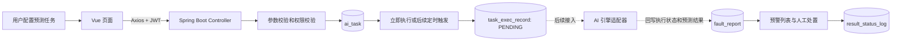
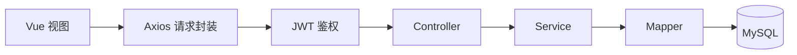

# AI 故障预测调用流程与 API 服务技术交流

> 适用场景：项目技术交流、阶段答辩和模块交接。  
> 文档版本：1.0；更新日期：2026-08-21。

## 1. 交流结论

AI 故障预测模块已完成平台侧的业务闭环：任务配置、数据校验、权限控制、执行受理、执行记录、预警展示和人工处置均已落地。当前“立即执行”会创建待处理的执行记录，状态为 `PENDING`，用于等待后续接入的 AI 推理引擎。

**当前尚未接入真实模型推理、模型 HTTP 调用、消息队列、自动调度器和公开引擎回调接口。** 因此，平台不会伪造预测成功或预警结果；真实模型接入后，只需在既有任务和执行记录边界上增加适配器即可。

配套可编辑 FigJam 图：

- [AI 故障预测调用流程](https://www.figma.com/board/DZOFKU3TQjQIFCslDABPG1?utm_source=other&utm_content=edit_in_figjam)
- [AI API 分层与接口调用流程](https://www.figma.com/board/ddiJUgBWJLw52WnarLBUSZ?utm_source=other&utm_content=edit_in_figjam)

## 2. AI 故障预测调用流程与功能模块

### 2.1 模块划分

| 模块 | 页面/接口职责 | 核心数据 |
| --- | --- | --- |
| 故障知识库管理 | 管理故障案例、附件、知识内容，支撑未来模型知识增强 | `kb_instance`、`kb_attachment` |
| 故障预测任务配置 | 维护预测对象、AI 模型、22 项指标和定时规则 | `ai_model`、`ai_task` |
| 任务执行记录 | 记录人工或后续定时触发的受理、执行结果与失败信息 | `task_exec_record` |
| 故障智能预警 | 展示模型未来产生的预警，并完成确认、误报标记和关闭 | `fault_report`、`result_status_log` |
| 权限与审计 | 控制角色访问范围，记录新增、修改、删除和执行操作 | 权限菜单、审计日志 |

其中，`ai_task.task_type` 固定为 `FAULT_PREDICTION`，实现与缺陷检测、性能优化任务的统一存储和分类隔离。

### 2.2 端到端调用流程



调用步骤说明：

1. 管理员或操作员在前端选择业务系统或分布式数据库、启用的故障预测模型、指标集合和每日/每周规则。
2. 前端经 Axios 携带 JWT 访问 Spring Boot API；拦截器先验证登录状态与接口权限。
3. Controller 使用 `@Valid` 校验请求格式，Service 再校验模型启用状态、目标对象存在性、指标重复、调度规则和任务编码唯一性。
4. 保存成功后，任务配置写入 `ai_task`：指标写入 `metric_codes`，定时规则以 JSON 写入 `schedule_rule`，`param_json` 留存引擎契约版本。
5. 用户点击“立即执行”后，平台写入一条 `task_exec_record`，状态为 `PENDING`、结果数为 `0`，并更新任务执行次数及最后执行时间。
6. 后续 AI 引擎应读取或订阅 `PENDING` 记录，获取任务配置和监控数据，执行推理后将状态更新为 `RUNNING`、`SUCCESS` 或 `FAILED`，并写入 `fault_report`。
7. 人工在故障智能预警中处理结果，状态按 `PENDING -> CONFIRMED/FALSE_POSITIVE -> CLOSED` 流转，处置备注写入 `result_status_log`，形成可审计闭环。

### 2.3 核心业务规则

- 预测对象类型只允许 `BUSINESS_SYSTEM` 与 `DB_RESOURCE`，并由后端校验目标存在。
- 每个任务至少选择一项、最多选择 22 项预测指标；后端拒绝空白和重复指标。
- 定时规则仅允许 `daily` 或 `weekly`；时间格式为 `HH:mm`；每周规则必须指定星期；预测窗口为 `1/2/4/12/24` 小时。
- 专用新增接口由服务端生成任务编码；编辑时服务端保留旧编码，前端无需传递内部编码。
- 执行状态的 `PENDING` 表示“平台已受理，等待 AI 引擎处理”，不代表模型已运行成功。
- 预警处置必须遵守状态机，非法跳转和缺失处理备注会被拒绝。

### 2.4 角色权限边界

| 角色 | 查询与详情 | 新增/编辑 | 立即执行 | 删除 |
| --- | --- | --- | --- | --- |
| `admin` | 允许 | 允许 | 允许 | 允许 |
| `operator` | 允许 | 允许 | 允许 | 不允许 |
| `viewer` | 允许 | 不允许 | 不允许 | 不允许 |

接口权限由 `JwtAuthInterceptor` 集中匹配，例如任务查询需要 `ai:task:view`，立即执行需要 `ai:task:execute`，预警处置需要 `ai:fault:handle`。

## 3. API 服务、接口设计及核心代码示例

### 3.1 分层设计



- **前端层**：页面负责表单交互、字段回显和错误提示；不承担权限判断和核心数据校验。
- **Controller 层**：定义 REST 路由、接收 DTO、触发 Bean Validation，并返回统一 `ApiResponse`。
- **Service 层**：承载事务、领域校验、状态机、审计与跨表编排。
- **Mapper 层**：通过 MyBatis-Plus 执行数据访问，不暴露业务规则。
- **数据层**：任务、执行记录、预警结果和处理日志使用关联主键形成链路。

统一响应结构如下，`traceId` 可用于定位日志和异常：

```json
{
  "code": 200,
  "message": "success",
  "data": {},
  "traceId": "0a4dc64f-9d4f-4ee6-8e7c-cf147a9f451f",
  "timestamp": "2026-08-21T08:00:00Z"
}
```

### 3.2 关键接口

基础路径为 `/api`，下表省略该前缀。

| 方法 | 地址 | 权限 | 用途 |
| --- | --- | --- | --- |
| `GET` | `/ai/fault-prediction/tasks` | `ai:task:view` | 分页查询故障预测任务 |
| `GET` | `/ai/fault-prediction/tasks/{id}` | `ai:task:view` | 查询任务详情、执行记录摘要和关联预警 |
| `POST` | `/ai/fault-prediction/tasks` | `ai:task:create` | 新增任务，由服务端生成任务编码 |
| `PUT` | `/ai/fault-prediction/tasks/{id}` | `ai:task:update` | 更新任务配置，保持原任务编码 |
| `DELETE` | `/ai/fault-prediction/tasks/{id}` | `ai:task:delete` | 删除任务 |
| `POST` | `/ai/fault-prediction/tasks/{id}/execute` | `ai:task:execute` | 创建待引擎处理的执行记录 |
| `GET` | `/ai/fault-prediction/alerts` | `ai:fault:view` | 分页查询故障预警 |
| `GET` | `/ai/fault-prediction/alerts/{id}` | `ai:fault:view` | 查询预警及处理历史 |
| `PATCH` | `/ai/fault-prediction/alerts/{id}/handle` | `ai:fault:handle` | 人工确认、标记误报或关闭预警 |

### 3.3 新建任务请求示例

```http
POST /api/ai/fault-prediction/tasks
Authorization: Bearer <JWT>
Content-Type: application/json
```

```json
{
  "taskName": "核心库连接数预测",
  "modelId": 1001,
  "targetType": "DB_RESOURCE",
  "targetId": 2001,
  "metricCodes": ["mysql_threads_connected", "mysql_slow_queries"],
  "schedules": [
    {
      "time": "09:00",
      "repeatType": "daily",
      "weekDays": [],
      "predictionWindowHours": 4
    }
  ]
}
```

`taskCode` 不属于专用接口的前端入参。创建时由服务端生成；编辑时从原记录继承，避免客户端篡改或遗漏内部编码。

### 3.4 立即执行请求与响应语义

```http
POST /api/ai/fault-prediction/tasks/3001/execute
Authorization: Bearer <JWT>
Content-Type: application/json

{"triggerType":"MANUAL"}
```

成功后返回执行记录。其关键字段为 `executionStatus=PENDING`、`startTime`、`resultCount=0`。前端应展示“已受理，等待 AI 引擎处理”，而不是“预测完成”。

### 3.5 核心代码示例

以下代码来自项目现有实现，删减了与主题无关的 import 和 getter/setter。

**1. 专用 Controller：DTO 校验与统一响应**  
来源：[FaultPredictionTaskController.java](../../apps/api-server/src/main/java/com/xinchuang/diagnosis/ai/controller/FaultPredictionTaskController.java)

```java
@RestController
@RequestMapping("/ai/fault-prediction/tasks")
public class FaultPredictionTaskController {
    private final FaultPredictionTaskService faultTaskService;

    @PostMapping
    public ApiResponse<FaultTaskDetailVO> create(
            @Valid @RequestBody FaultTaskSaveRequest request) {
        return ApiResponse.ok(faultTaskService.create(request));
    }

    @PostMapping("/{id}/execute")
    public ApiResponse<TaskExecRecord> execute(
            @PathVariable Long id,
            @Valid @RequestBody TaskExecuteRequest request) {
        return ApiResponse.ok(faultTaskService.execute(id, request));
    }
}
```

**2. 执行受理：只创建待处理记录，不伪造模型结果**  
来源：[AiManagementServiceImpl.java](../../apps/api-server/src/main/java/com/xinchuang/diagnosis/ai/service/impl/AiManagementServiceImpl.java)

```java
public TaskExecRecord executeTask(Long id, TaskExecuteRequest request) {
    AiTask task = taskDetail(id);
    TaskExecRecord record = new TaskExecRecord();
    record.setTaskId(id);
    record.setTaskType(task.getTaskType());
    record.setTaskNameSnapshot(task.getTaskName());

    boolean waitingForEngine = isEngineTask(task.getTaskType());
    record.setExecutionStatus(waitingForEngine ? "PENDING" : "SUCCESS");
    record.setTriggerType(StringUtils.hasText(request.getTriggerType())
        ? request.getTriggerType() : "MANUAL");
    record.setStartTime(LocalDateTime.now());
    record.setResultCount(0);
    taskExecRecordMapper.insert(record);

    task.setExecutionCount((task.getExecutionCount() == null ? 0 : task.getExecutionCount()) + 1);
    task.setLastExecTime(record.getStartTime());
    aiTaskMapper.updateById(task);
    return record;
}
```

**3. 未来引擎适配边界：更新执行状态**  
来源：[FaultPredictionTaskServiceImpl.java](../../apps/api-server/src/main/java/com/xinchuang/diagnosis/ai/service/impl/FaultPredictionTaskServiceImpl.java)

```java
@Transactional(rollbackFor = Exception.class)
public TaskExecRecord updateExecutionFromEngine(
        Long taskId, Long executionId, FaultTaskExecutionUpdateRequest request) {
    faultTask(taskId);
    TaskExecRecord record = taskExecRecordMapper.selectById(executionId);
    if (record == null || !taskId.equals(record.getTaskId())
            || !"FAULT_PREDICTION".equals(record.getTaskType())) {
        throw new BusinessException("故障预测执行记录不存在");
    }
    if (("SUCCESS".equals(request.getExecutionStatus())
            || "FAILED".equals(request.getExecutionStatus()))
            && request.getEndTime() == null) {
        throw new BusinessException("已完成执行必须提供结束时间");
    }
    record.setExecutionStatus(request.getExecutionStatus());
    record.setStartTime(request.getStartTime());
    record.setEndTime(request.getEndTime());
    record.setResultCount(request.getResultCount());
    record.setErrorMessage(request.getErrorMessage());
    taskExecRecordMapper.updateById(record);
    return record;
}
```

该方法是**内部服务契约**，当前没有对外 HTTP Controller。未来接入时，应在认证后的引擎适配层调用它，或在该边界外增加受签名保护的回调接口，不能让前端直接写入执行状态。

## 4. 后续模型接入建议

建议通过独立的“AI 引擎适配层”对接模型服务，保持现有前端 API 和数据库结构稳定：

1. 适配层读取或订阅 `PENDING` 执行记录，按任务读取目标、指标、时间窗口和模型参数。
2. 适配层从监控/台账数据源获取特征，调用模型推理服务，并先将执行记录置为 `RUNNING`。
3. 成功时在同一事务或可靠消息流程中写入 `fault_report`，更新执行记录为 `SUCCESS`；失败时写入 `FAILED` 和脱敏后的失败原因。
4. 回调接口应使用服务身份认证、时间戳和签名校验，并校验任务与执行记录归属，防止重放、越权和跨任务篡改。
5. 任务调度建议由独立调度器依据 `schedule_rule` 触发，避免把定时逻辑耦合进页面或 Controller。

## 5. 代码与相关资料索引

| 类型 | 路径 |
| --- | --- |
| 任务接口 | `apps/api-server/src/main/java/com/xinchuang/diagnosis/ai/controller/FaultPredictionTaskController.java` |
| 预警接口 | `apps/api-server/src/main/java/com/xinchuang/diagnosis/ai/controller/FaultAlertController.java` |
| 任务业务服务 | `apps/api-server/src/main/java/com/xinchuang/diagnosis/ai/service/impl/FaultPredictionTaskServiceImpl.java` |
| 通用任务执行实现 | `apps/api-server/src/main/java/com/xinchuang/diagnosis/ai/service/impl/AiManagementServiceImpl.java` |
| 任务请求 DTO | `apps/api-server/src/main/java/com/xinchuang/diagnosis/ai/dto/FaultTaskSaveRequest.java` |
| 引擎状态更新 DTO | `apps/api-server/src/main/java/com/xinchuang/diagnosis/ai/dto/FaultTaskExecutionUpdateRequest.java` |
| 模块说明 | `docs/modules/ai-fault-prediction/task-config.md` |
| 数据库设计摘要 | `docs/context/requirements/database-design.md` |
| 流程图说明 | `docs/diagrams/ai-api-flow-diagrams.md` |

## 6. 交流时的推荐表述

“项目已经把 AI 故障预测的平台能力做成了可扩展闭环：用户可以配置任务、选择对象和指标、提交执行，平台会以 `PENDING` 状态可靠受理并记录审计；未来 AI 引擎只需从这一稳定边界取任务、完成推理并回写结果，预警模块即可按既有状态机进入人工处置。当前展示的是平台侧工程能力，不把预留的模型推理误称为已经落地的 AI 算法。”
