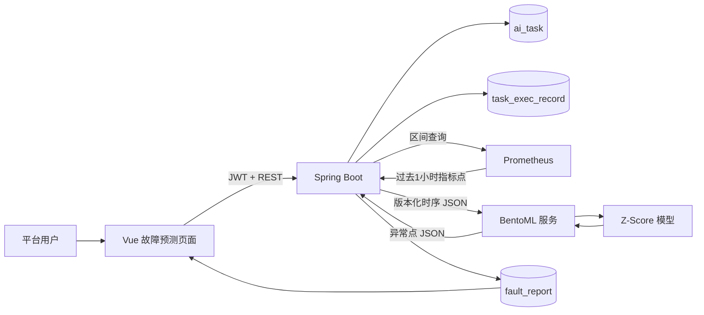

# BentoML 与 AI 故障预测

## 1. BentoML 简介

### 1.1 BentoML 是什么

BentoML 是AI引擎的一类，具体地说，是面向机器学习模型的 Python 服务化框架。它负责把模型推理逻辑包装成稳定的网络服务，并提供请求校验、HTTP API、模型打包、运行和部署等能力。

在本项目中，可以把 BentoML 理解为 **Spring Boot 平台与 Python 模型之间的模型服务层**：

- Spring Boot 负责业务流程、权限、任务状态、Prometheus 查询和结果落库。
- BentoML 负责接收标准化时序数据、调用 Python 模型并返回结构化推理结果。
- 模型负责具体算法计算。

因此，BentoML 可以被称为“AI 引擎服务框架”或“模型服务框架”。

### 1.2 BentoML 在系统中的定位

| 组件 | 主要职责 |
| --- | --- |
| Vue 管理端 | 任务配置、立即执行、状态和预警展示 |
| Spring Boot | 鉴权、任务编排、数据查询、契约转换、状态管理、预警落库 |
| Prometheus | 保存和查询真实监控时序数据 |
| BentoML | 暴露模型 API、校验输入、执行推理、返回结果 |
| 模型 | 计算 |

### 1.3 为什么选择 BentoML

1. Java 与 Python 通过 HTTP/JSON 解耦，避免在 JVM 中直接加载 Python 模型。
2. 模型进程可以独立启动、扩容、发布和回滚。
3. 请求和响应使用显式数据模型，便于前后端联调和契约测试。
4. Spring Boot 保留业务控制权，Prometheus 地址、认证信息和数据库权限无需下发给模型服务。
5. 当前验证模型可以平滑替换为真实模型，而不改变平台对外接口。

## 2. 目前的能力边界

目前完成的是一个可使用、可追踪、可失败恢复的时序异常检测闭环。

| 项目 | 第一版实现 |
| --- | --- |
| 执行入口 | 故障预测任务页面的“立即执行” |
| 执行方式 | Spring Boot 事务提交后异步执行 |
| 数据对象 | 仅 `DB_RESOURCE`，即分布式数据库资源 |
| 数据窗口 | 固定读取执行时刻之前 1 小时 |
| 采样步长 | 60 秒 |
| 已接入指标 | CPU、内存、磁盘 IO、数据库连接数、缓存命中率 |
| 暂未接入指标 | 页面保留另外 17 项，按钮置灰并显示“暂未开发” |
| 模型 | BentoML 中的 Z-Score 异常检测模型 |
| 结果 | 每个指标最多生成一条最强异常预警 |
| 状态 | `PENDING -> RUNNING -> SUCCESS/FAILED` |
| 恢复 | 每 30 秒扫描遗留任务，超过 5 分钟的 `RUNNING` 重新排队 |
| 网络重试 | BentoML 返回服务不可用时，首次失败后最多重试 2 次 |

## 3. 总体架构



## 5. Spring Boot 与 BentoML 数据传输

### 5.1 请求示例

```json
{
  "contractVersion": "1.0",
  "requestId": "execution-10001",
  "modelCode": "zscore-communication-test",
  "timestamps": [1787792400, 1787792460, 1787792520],
  "features": {
    "cpu_usage": [31.2, 32.0, 91.8],
    "memory_usage": [58.1, 58.4, 59.0]
  },
  "threshold": 1.5
}
```

关键约束：

- `contractVersion` 用于双方识别协议版本。
- `requestId` 由执行记录 ID 派生，用于日志追踪和响应关联。
- `timestamps` 与每个 `features` 数组长度必须完全一致。
- 第一版允许 3 到 20,000 个时间点，最多 22 个指标。
- `threshold` 必须大于 0，当前默认值为 `1.5`。

### 5.2 响应示例

```json
{
  "contractVersion": "1.0",
  "requestId": "execution-10001",
  "engine": "BentoML",
  "modelCode": "zscore-communication-test",
  "modelVersion": "communication-test-1.0.0",
  "pointCount": 3,
  "anomalies": [
    {
      "metricCode": "cpu_usage",
      "index": 2,
      "timestamp": 1787792520,
      "value": 91.8,
      "score": 1.67
    }
  ]
}
```

`anomalies` 为空不代表服务调用失败，而是表示当前阈值下没有检测到异常点。

### 5.3 指标编码映射

| 平台中文指标 | Prometheus 内部编码 | BentoML 特征编码 |
| --- | --- | --- |
| CPU | `cpuUsage` | `cpu_usage` |
| 内存 | `memoryUsage` | `memory_usage` |
| 磁盘IO | `diskIops` | `disk_iops` |
| 数据库连接数 | `currentConnections` | `current_connections` |
| 缓存命中率 | `cacheHitRate` | `cache_hit_rate` |

## 6. 关键伪代码举例

以下示例是对当前实现的抽象，重点表达业务顺序和可靠性设计，不要求与生产源码逐行相同。

### 6.1 受理任务并在事务后派发

```text
function executeTask(taskId):
    task = loadFaultPredictionTask(taskId)
    require task.targetType == DB_RESOURCE
    require all task.metrics are supported

    transaction:
        now = currentBusinessTime()
        execution = insert task_exec_record(
            taskId = task.id,
            status = PENDING,
            inputStartTime = now - 1 hour,
            inputEndTime = now,
            resultCount = 0
        )
        publish ExecutionRequested(execution.id)

    // 监听器仅在事务提交成功后进入线程池
    afterCommit:
        asyncExecutor.submit(execution.id)

    return execution
```

### 6.3 查询并对齐 Prometheus 数据

```text
function loadPrometheusInput(task, execution):
    resource = loadDbResource(task.targetId)
    config = loadMonitoringConfig(resource.id)

    require resource.monitorStatus == NORMAL
    require config.status == HEALTHY

    range = [execution.inputStartTime, execution.inputEndTime]
    seriesByMetric = prometheus.queryRange(
        baseUrl = config.baseUrl,
        authRef = config.authRef,
        selectors = config.selectors,
        metrics = mapToPrometheusCodes(task.metrics),
        range = range,
        step = 60 seconds
    )

    alignedPoints = alignByTimestamp(seriesByMetric)
    alignedPoints = keep points where every selected metric has a value
    require alignedPoints.size >= 3

    return {
        timestamps: alignedPoints.timestamps,
        features: mapToEngineFeatureArrays(alignedPoints)
    }
```

### 6.4 BentoML 模型服务

```python
@bentoml.service(name="time-series-anomaly-verification")
class TimeSeriesAnomalyService:

    @bentoml.api
    def predict(request):
        validate request.timestamps and request.features
        anomalies = []

        for metric_code, values in request.features:
            mean = average(values)
            std = standard_deviation(values)

            for index, value in values:
                score = 0 if std == 0 else abs(value - mean) / std
                if score >= request.threshold:
                    anomalies.add(
                        metricCode = metric_code,
                        index = index,
                        timestamp = request.timestamps[index],
                        value = value,
                        score = score
                    )

        return response(
            contractVersion = request.contractVersion,
            requestId = request.requestId,
            modelVersion = "communication-test-1.0.0",
            pointCount = request.timestamps.size,
            anomalies = anomalies
        )
```

### 6.5 BentoML 调用与有限重试

```text
function predictWithRetry(request):
    for attempt from 1 to 3:
        try:
            response = POST bentomlBaseUrl + "/predict" with request
            require response.requestId == request.requestId
            require response.contractVersion == request.contractVersion
            require response.pointCount == request.timestamps.size
            require response.anomalies is not null
            return response
        catch error:
            if error is not SERVICE_UNAVAILABLE or attempt == 3:
                throw error
            wait 300ms * attempt
```
